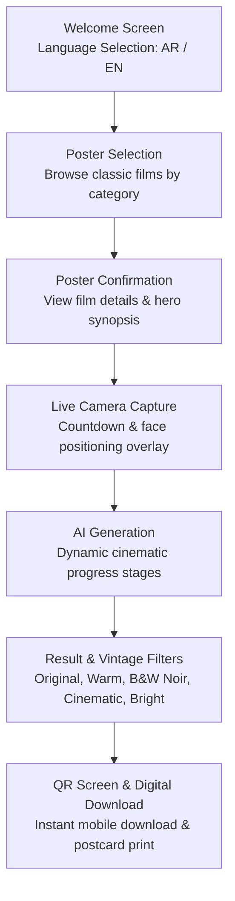

# El Gouna Film Festival Photo Booth (مهرجان الجونة السينمائي)
### *بطل البوستر — The Star of the Poster*
**Sponsored by Emirates NBD (بنك الإمارات دبي الوطني)**

[](https://react.dev/)
[](https://www.typescriptlang.org/)
[](https://vitejs.dev/)
[](https://www.framer.com/motion/)
[](https://deepmind.google/technologies/gemini/)

An interactive, AI-driven cinematic photo booth kiosk experience designed for vertical touch displays (1080×1920 portrait kiosk grid, 9:16 aspect ratio). Developed for the **El Gouna Film Festival**, this booth allows festival attendees to step into the shoes of classic Egyptian cinema legends and immortalize their experience on iconic film posters.

---

## Table of Contents
1. [Non-Technical Overview & User Experience](#non-technical-overview--user-experience)
   - [Concept & Festival Theme](#concept--festival-theme)
   - [Interactive Kiosk Workflow](#interactive-kiosk-workflow)
   - [Bilingual Support](#bilingual-support)
   - [Printable Postcards & Keepsakes](#printable-postcards--keepsakes)
2. [Technical Architecture & Stack](#technical-architecture--stack)
   - [Frontend Architecture](#frontend-architecture)
   - [Backend & Serverless Architecture](#backend--serverless-architecture)
   - [AI Face-Swap & Generative Pipeline](#ai-face-swap--generative-pipeline)
   - [Cloud Storage & QR Distribution](#cloud-storage--qr-distribution)
   - [Canvas Print Rendering Engine](#canvas-print-rendering-engine)
3. [Project Directory Structure](#project-directory-structure)
4. [Environment Configuration](#environment-configuration)
5. [Getting Started & Local Development](#getting-started--local-development)
6. [Deployment (Vercel)](#deployment-vercel)
7. [Hardware & Kiosk Display Recommendations](#hardware--kiosk-display-recommendations)

---

## Non-Technical Overview & User Experience

### Concept & Festival Theme
Classic cinema holds a revered place in Egyptian and Arab cultural memory. *بطل البوستر / The Star of the Poster* brings festival attendees into this golden age of cinema by placing them directly onto vintage film posters from celebrated masterpieces (*الحريف / The Streetplayer*, *ولاد الإيه / Welad El-Eih*, *الأيام / The Days*, *الأب الروحي / The Godfather*, and more).

The visual identity combines vintage film grain, warm champagne gold hues (`#c9a227`), deep cinematic charcoal, and authentic theatrical calligraphy.

---

### Interactive Kiosk Workflow



1. **Welcome Screen (`WelcomeScreen`)**:
   - Atmospheric cinematic background with official festival branding and sponsor recognition (**Emirates NBD**).
   - Dynamic toggle buttons for **العربية** and **English** with glowing active indicators.
   - Seamless transition to the experience.

2. **Poster Selection (`PosterSelectionScreen`)**:
   - Curated catalog of classic movies categorized by genre (**All**, **Drama**, **Comedy**, **Action**, **Romance**).
   - High-resolution poster cards featuring vintage textures and cinematic vignettes.

3. **Poster Confirmation (`PosterConfirmScreen`)**:
   - Focused preview of the chosen movie with character role context, allowing attendees to confirm their selection or return to browse.

4. **Live Camera Capture (`CameraScreen`)**:
   - Fullscreen video feed with user-facing alignment guides.
   - 3-second animated countdown with audible/visual pacing.
   - Retake capability to ensure the perfect shot.

5. **AI Generation Stage (`GeneratingScreen`)**:
   - Entertaining cinematic loader reflecting four choreographed progress steps:
     * *Analyzing your portrait...* (تحليل صورتك)
     * *Blending into poster...* (دمج الملصق)
     * *Applying vintage lighting & grain...* (إضافة اللمسات الفنية)
     * *Finalizing cinematic masterpiece...* (الانتهاء من التحفة الفنية)

6. **Filter & Refinement Studio (`EditScreen` & `ResultScreen`)**:
   - Immediate high-definition reveal of the personalized poster.
   - Interactive vintage photo filters:
     * **Original** (Natural AI composite)
     * **Warm** (Golden sepia glow)
     * **B&W** (Classic film noir monochrome)
     * **Cinematic** (High-contrast 1970s film grade)
     * **Bright** (Illuminated festival spotlight)

7. **Take-Home Keepsake & QR Download (`QRScreen` & `DownloadPage`)**:
   - Real-time QR code generation allowing attendees to immediately download their high-resolution poster to their smartphone.
   - High-resolution printable postcard generator integrating official festival emblems and gold borders.

---

### Bilingual Support
The booth provides complete, native bilingual support:
- **Arabic (Default)**: RTL layout, custom Egyptian typography (**Rakkas**), and localized festival copy.
- **English**: LTR layout, elegant cinema display typography, and tailored English film titles and taglines.
- Instant, non-destructive switching on the Welcome screen updates the entire experience context seamlessly.

---

### Printable Postcards & Keepsakes
Beyond the digital poster, the kiosk features a dedicated 1200×1800 canvas export utility (`framePhoto.ts`):
- High-resolution postcard format (3:2 print ratio).
- **Intelligent adaptive background coloring** that samples color tones from the photo and darkens them to let gold badges pop.
- Delicate 3px gold borders surrounding the photograph and outer margins.
- Clean footer plaques honoring festival branding and **Emirates NBD**.

---

## Technical Architecture & Stack

### Frontend Architecture
- **React 19.2** + **TypeScript**: Strict type checking with componentized architecture.
- **Vite 8.3**: Ultra-fast HMR and optimized production bundling.
- **Framer Motion 14**: Spring-based physics, smooth page transitions, and tactile button micro-interactions.
- **React Router 7**: Multi-route support separating the kiosk shell from the mobile download destination (`/download/:id`).
- **Context API (`BoothContext`)**: Single centralized reducer managing wizard progression, movie metadata, captured photos, and active language state.

#### Typography & Font Hierarchy
| Role | Arabic Face | English Face | Fallback |
| :--- | :--- | :--- | :--- |
| **Festival Display / Title** | `Rakkas` | `Cormorant Garamond` | `serif` |
| **Headings & Badges** | `Rakkas` | `Montserrat` | `sans-serif` |
| **Body & UI Text** | `Readex Pro` | `Readex Pro` / `Montserrat` | `sans-serif` |

---

### Backend & Serverless Architecture
- **Dual Runtime Setup**:
  - **Local Development**: Express backend (`local-api.js`) running on port `3001` with CORS and 50MB payload handling.
  - **Production (Vercel)**: Serverless functions under `api/gouna/` configured via `vercel.json` with a 60-second execution budget.

---

### AI Face-Swap & Generative Pipeline
The AI generation pipeline is handled in [`api/gouna/generate.js`](api/gouna/generate.js) leveraging Google Gemini's multimodal image models:

- **Primary Models**:
  - `gemini-3-pro-image-preview`
  - `gemini-3.1-flash-image-preview`
  - `gemini-2.5-flash-image`
- **Identity & Consistency Rules**:
  - Preserves facial geometry, eyes, nose, jawline, skin tone, facial hair, and spectacles.
  - Suppresses modern artifacts (baseball caps, wireless headphones).
  - Matches source poster lighting, film grain, colour balance, and print texture.
- **Tailored Movie Prompts**: Each poster has custom prompt instructions defining hero replacement points (e.g., Marlon Brando's tuxedo in *The Godfather*, Ahmed Zaki in *Welad El-Eih*, Adel Emam in *El-Harreef*).

---

### Cloud Storage & QR Distribution
- **Image Hosting (`api/gouna/upload.js`)**: Uploads finalized posters to cloud hosting (ImgBB API) and retrieves public URLs.
- **QR Generation (`QRScreen.tsx`)**: Utilizes `qrcode.react` to generate scannable QR codes encoding the mobile web viewer URL.
- **Mobile Download Page (`DownloadPage.tsx`)**: Responsive mobile-friendly landing page with one-tap download capabilities.

---

### Canvas Print Rendering Engine
[`src/utils/framePhoto.ts`](src/utils/framePhoto.ts) performs automated client-side canvas generation:
```typescript
framePhoto(photoDataUrl: string): Promise<string>
```
1. Loads attendee photo alongside SVG/PNG vectors for festival and sponsor logos.
2. Analyzes bottom pixels of the photo converting **RGB to HSV** to create a darkened, harmonious background fill.
3. Centers and scales the photo inside the safe printable zone without distortion.
4. Draws outer and inner 3px metallic gold frames (`#c9a227`).
5. Places sponsor and festival insignia on rounded badges in the footer.
6. Exports a high-quality JPEG at `0.95` quality.

---

## Project Directory Structure

```text
gouna-photo/
├── api/                        # Serverless API routes (Vercel)
│   └── gouna/
│       ├── generate.js         # Multimodal Gemini poster generation handler
│       └── upload.js           # ImgBB image upload handler
├── public/
│   ├── elements/               # UI design assets (buttons, logos, titles)
│   │   ├── bg.png              # Atmospheric backdrop
│   │   ├── btn_primary.png     # Gold action button graphic
│   │   ├── compound_path.png   # Emirates NBD logo mask
│   │   ├── lang_en.png         # ON-state language toggle frame
│   │   ├── lang_ar.png         # OFF-state language toggle frame
│   │   ├── logo.png            # Arabic title (بطل البوستر)
│   │   ├── The star of the poster.png # English title
│   │   └── title.png           # El Gouna Film Festival logo
│   ├── fonts/                  # Self-hosted typography (Rakkas, Readex Pro)
│   └── posters/                # Classic movie posters catalog
├── src/
│   ├── api/
│   │   └── client.ts           # Frontend API client
│   ├── components/             # Reusable UI elements (BoothButton, Layouts)
│   ├── context/
│   │   └── BoothContext.tsx    # State management & session reducer
│   ├── data/
│   │   └── movies.ts           # Movie catalog and custom AI prompts
│   ├── i18n/
│   │   └── translations.ts     # Bilingual localization strings (AR / EN)
│   ├── pages/
│   │   └── DownloadPage.tsx    # Mobile QR landing page
│   ├── screens/                # Kiosk wizard screens
│   │   ├── WelcomeScreen.tsx   # Entry point & language switcher
│   │   ├── PosterSelectionScreen.tsx # Catalog browser
│   │   ├── PosterConfirmScreen.tsx   # Film confirmation
│   │   ├── CameraScreen.tsx    # WebRTC photo capture
│   │   ├── GeneratingScreen.tsx # Processing & animated steps
│   │   ├── ResultScreen.tsx    # Final poster display
│   │   ├── EditScreen.tsx      # Vintage filters selector
│   │   └── QRScreen.tsx        # QR code & print trigger
│   ├── types/
│   │   └── index.ts            # TypeScript interfaces & types
│   ├── utils/
│   │   └── framePhoto.ts       # 1200x1800 canvas print compositor
│   ├── App.tsx                 # Screen orchestrator & transitions
│   ├── index.css               # Design tokens & kiosk CSS layout
│   └── main.tsx                # React root mount
├── local-api.js                # Express local mock/proxy API server
├── package.json                # Dependencies and npm scripts
├── vercel.json                 # Vercel deployment & routing config
└── vite.config.ts              # Vite configuration
```

---

## Environment Configuration

Create a `.env` file in the root directory:

```env
# Google Gemini API key for generative face replacement
GEMINI_API_KEY=your_gemini_api_key_here

# ImgBB API key for uploading posters for QR download
IMGBB_API_KEY=your_imgbb_api_key_here

# Local API port (Optional, defaults to 3001)
PORT=3001
```

---

## Getting Started & Local Development

### 1. Prerequisites
- **Node.js**: v18.0.0 or higher
- **npm**: v9.0.0 or higher
- A working webcam connected to your workstation for testing the camera stage.

### 2. Installation
```bash
git clone https://github.com/Mohanned-Mahmoud/Gouna-Photo.git
cd Gouna-Photo
npm install
```

### 3. Launch Development Server
Runs both the Express API bridge and Vite dev server concurrently:
```bash
npm run dev
```
- **Kiosk Frontend**: `http://localhost:5173/`
- **Local API**: `http://localhost:3001/`

### 4. Code Quality & Verification
```bash
# Type check TypeScript codebase
npx tsc -b

# Run Oxlint
npm run lint

# Build production bundle
npm run build
```

---

## Deployment (Vercel)

The repository is configured for one-click deployment on **Vercel**:
1. Connect your repository to Vercel.
2. In **Project Settings → Environment Variables**, add:
   - `GEMINI_API_KEY`
   - `IMGBB_API_KEY`
3. Deploy! Vercel automatically runs `npm run build` and serves static files from `dist/` while directing API requests through `api/gouna/`.

---

## Hardware & Kiosk Display Recommendations

| Specification | Recommendation |
| :--- | :--- |
| **Orientation** | Portrait (Vertical 9:16) |
| **Native Resolution** | 1080 × 1920 Full HD |
| **Touchscreen Type** | PCAP / Optical Touch Surface |
| **Camera** | 1080p / 4K USB Web Camera mounted at eye level |
| **Browser Configuration** | Chromium in Kiosk Mode (`--kiosk --incognito --disable-pinch`) |
| **Touch Interaction** | Hover states are mirrored as tap states (`whileTap` in Framer Motion) |

---

### Credits & Acknowledgments
- **El Gouna Film Festival**: Celebrating Arab and international cinema.
- **Emirates NBD Egypt**: Official Festival Sponsor.
- Built with craftsmanship for cinematic festival experiences.
